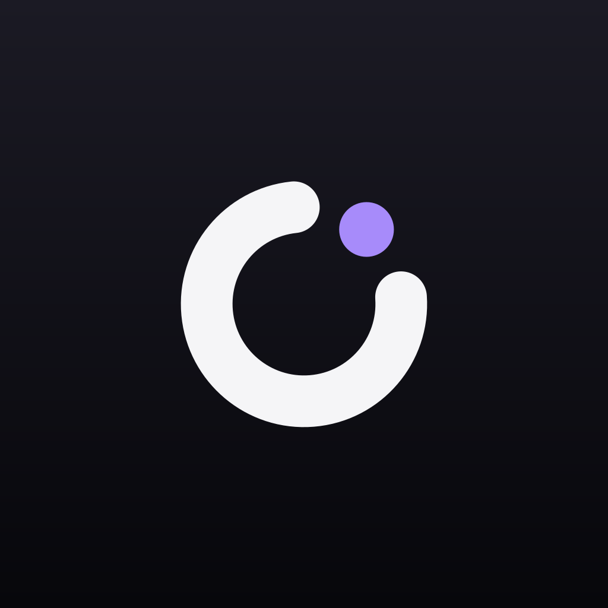
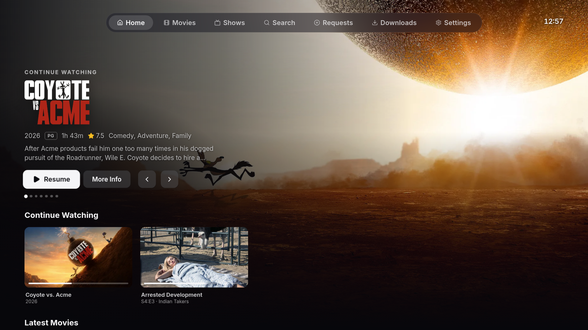
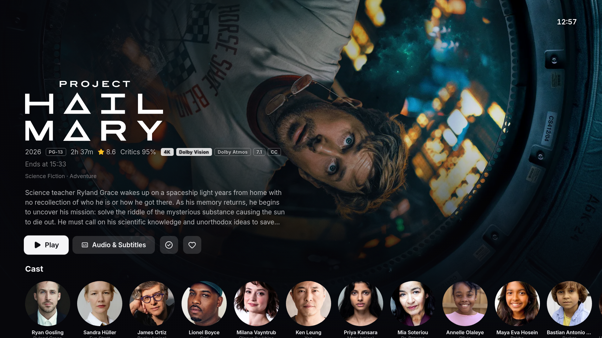
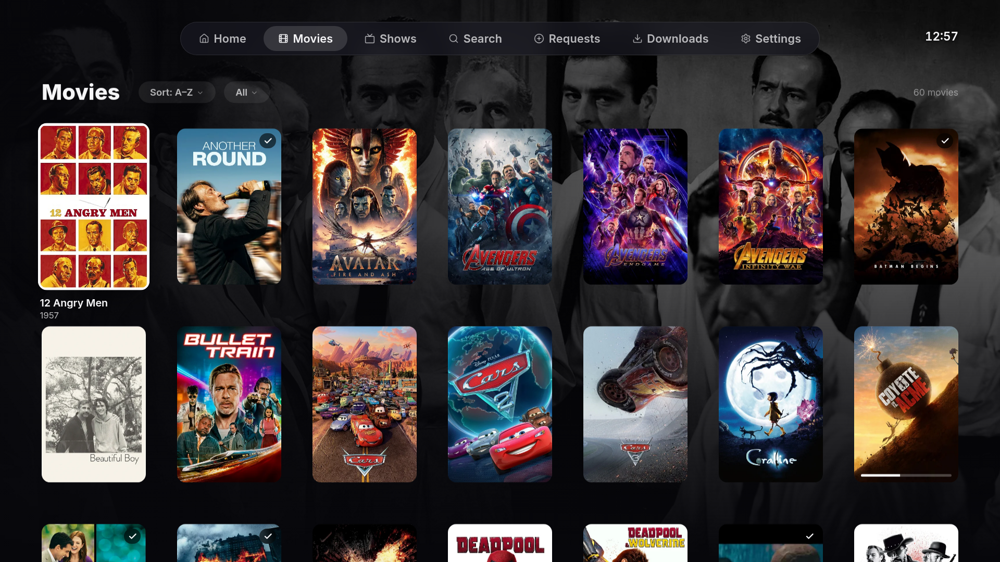
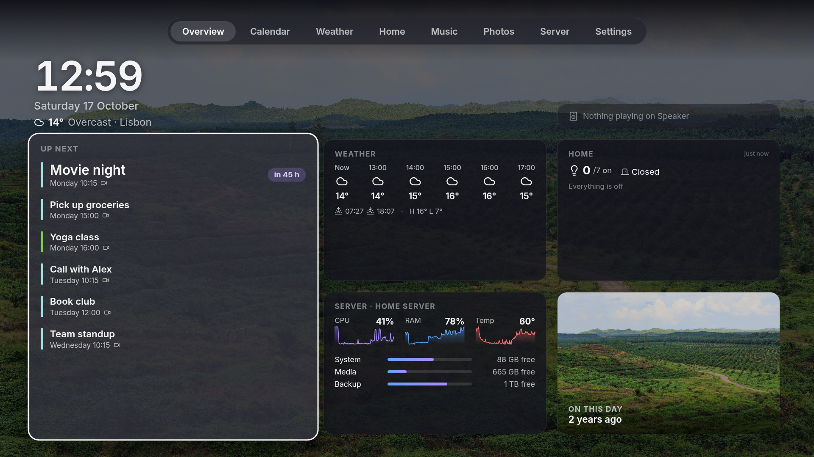

<p align="center">
  
</p>

<h1 align="center">JellyShell</h1>

<p align="center">
  A TV-first, Apple&nbsp;TV-style client for <a href="https://jellyfin.org">Jellyfin</a>, made to be used from the couch with a controller. Built for the <b>Xbox</b> first,
  with Android&nbsp;TV, phone and browser builds from the same code.
</p>

<p align="center">
  
  
  
  
</p>

> **Status:** used every day on the author's own setup; expect some rough edges on yours.
> The Xbox app is **not on the public Microsoft Store yet**. A public listing will happen if there's enough demand:
> star the repo or comment on the "Store listing" issue if you want it. Until then, build it yourself and sideload it in Dev Mode.

JellyShell is an independent project. It is not affiliated with or endorsed by the Jellyfin project.

## Why

The official Xbox app wraps jellyfin-web and tops out at 1080p. JellyShell draws its own controller-first UI in a
WebView2 and hands video to the console's native media pipeline, so 4K HEVC, HDR10 and Dolby Vision files direct-play,
with HDMI mode and frame-rate switching.

## Features

- **Controller-first UI**: translucent top tab bar (LB/RB), a focus engine tuned for the D-pad, calm crossfades, a
  TV-safe layout. Mouse/keyboard and touch work too (with a phone layout).
- **Native playback on Xbox**: 4K HEVC, HDR10, Dolby Vision and E-AC3/Atmos via Media Foundation. TrueHD and DTS go
  through FFmpegInteropX. Match frame rate. HDR on/off/auto, with server-side tone mapping (and a brightness control) for
  SDR TVs.
- **Watching**: Continue Watching and Next Up, an episode picker in the player, intro and recap auto-skip (Intro Skipper
  segments) with a next-episode countdown, "Are you still watching?", per-series audio/subtitle memory, audio boost and
  night mode.
- **Browsing**: Home rows, Movies and Shows libraries with sort and filters, search, cast and person pages, release dates.
- **Optional integrations** (each turns itself off when not configured):
  - **Seerr / Jellyseerr / Overseerr**: request movies and shows, "My Requests", TMDB pages for titles you don't have yet.
  - **Sonarr / Radarr / qBittorrent**: a read-only Downloads queue with live speed and ETA, plus a release calendar (admins).
  - **Bazarr**: find, download and re-sync subtitles right from the player (admins).
- **Optional dashboard ("Dash")**: a second side of the Xbox app (View button) with a clock, weather, calendar, Apple Home
  status, Immich photo memories, server stats and HomePod now-playing.
- **Sharing**: an optional hardened public listener for a reverse proxy, Tailscale Funnel or Cloudflare Tunnel, with
  per-user capabilities and rate limits.

## How it fits together

```
 Xbox app (UWP)          Android TV / phone          any browser
 WebView2 + native       WebView wrapper
 media player                  │                          │
      │                        │                          │
      └──────────────┬─────────┴──────────────────────────┘
                     ▼
        JellyShell page server  (Docker, :8097)          optional: Dash server (:8098)
        web UI + proxies for Seerr / *arr / Bazarr
                     │
                     ▼
              your Jellyfin  (+ optional Seerr, Sonarr, Radarr, qBittorrent, Bazarr)
```

| Folder | What |
|---|---|
| `web/` | The UI (Vite + Preact + TypeScript), shared by every client |
| `web-poc/` | The page server (Python, stdlib only). Serves the UI and keeps integration API keys server-side |
| `shell/XboxShell/` | The Xbox app (UWP, C#): a full-screen WebView2 over a native `MediaPlayerElement` |
| `android/` | Android TV and phone app (a Kotlin WebView wrapper, two flavors) |
| `dash/` | Optional dashboard: web UI, server, macOS agent for Calendar/Home, HomePod sidecar |
| `docs/` | Bridge contract, controller UX spec, configuration and build docs |

The page server is optional for the Xbox app: it also ships a bundled copy of the UI that talks to Jellyfin directly
(without Requests, Downloads or subtitle tools in that mode).

## Quick start (server)

You need Docker with Compose 2.24 or newer, and a Jellyfin server (tested with 10.11).

```sh
git clone https://github.com/DmytroKhrishu/jellyshell.git jellyshell && cd jellyshell
cp .env.example .env          # optional: everything has a default or is off
docker compose up -d --build
```

Open `http://<server-ip>:8097` in a browser to check it, and log in with your Jellyfin account or Quick Connect.
By default the container reaches Jellyfin on the Docker host at `:8096`. Set `JELLYFIN_URL` if yours lives elsewhere,
and `JELLYFIN_PUBLIC_URL` to the address clients should log in to.

Each integration is a couple of lines in `.env`:

```ini
SEERR_URL=http://host.docker.internal:5055
SEERR_API_KEY=...
SONARR_URL=http://host.docker.internal:8989
SONARR_API_KEY=...
RADARR_URL=http://host.docker.internal:7878
RADARR_API_KEY=...
BAZARR_URL=http://host.docker.internal:6767
BAZARR_API_KEY=...
JELLYFIN_API_KEY=...          # needed for the subtitle tools and the HDR picture control
```

Alternatively, mount your *arr config folders read-only and set `ARR_CONFIG_DIR`; the keys are then read from there.

- The dashboard is a separate compose profile: `docker compose --profile dash up -d --build`.
- Without Docker: run `cd web && npm ci && npm run build`, then `python3 web-poc/server.py`. It reads the same `.env`.

Full reference: [configuration](docs/configuration.md) · [Docker](docs/docker.md) · [public access](docs/public-access.md)

### Using different services

The integrations are the ones the author runs (Seerr, Sonarr/Radarr, qBittorrent, Bazarr, Immich, Apple Home via a Mac
agent, a HomePod). Anything you don't use can stay unset and its feature hides itself. To plug in something else
(Transmission, Home Assistant, Google Calendar, PhotoPrism, Sonos, ...), see
**[docs/integrations.md](docs/integrations.md)**. It lists, per feature, the one server function to replace and the
JSON shape the UI expects. Calendar and Home take plain JSON pushes, so any script can feed them. The page is written
so you can also hand it to an AI coding agent: "make the Dash use Home Assistant, following docs/integrations.md".

## Clients

### Xbox (Dev Mode sideload)

1. Fork the repo and run **Actions → build-shell** (or push a change under `shell/`). It builds the web UI, bundles it into
   the package and uploads the `jellyshell-x64` artifact. No secrets are needed to try it; add a signing certificate to
   get in-place updates.
2. Put the console in Developer Mode, open Device Portal (`https://<xbox-ip>:11443`), and install the `.msix` together
   with the dependency packages from the artifact.
3. Launch JellyShell. On first run, enter your Jellyfin address and, optionally, your JellyShell server
   (`http://<server-ip>:8097/`). You can change both later in Settings.

You can also bake default server addresses into your build with the `JELLYSHELL_MEDIA_URL` / `JELLYSHELL_PUBLIC_URL`
repo secrets. Local Visual Studio builds work too. Step by step: [docs/building.md](docs/building.md).

### Android TV and Android phones

```sh
cd android
./gradlew assembleTvRelease assembleMobileRelease \
  -PJELLYSHELL_DEFAULT_URL=http://192.168.1.10:8097/    # optional; empty = ask on first launch
```

You need JDK 17 or newer and the Android SDK (platform and build-tools 35). Output:

- `app/build/outputs/apk/tv/release/app-tv-release.apk`: Android TV / Google TV (leanback launcher, D-pad)
- `app/build/outputs/apk/mobile/release/app-mobile-release.apk`: phones and tablets (touch layout)

Both are thin wrappers that load your page server. The same build runs in CI (**Actions → build-android**).
Signing, app ids and installing with `adb`: [docs/building.md](docs/building.md#android-tv--phone-app).

### Browser

Any modern browser can open `http://<server-ip>:8097` directly (desktop and phone layouts). Direct play depends on what
the browser can decode; Jellyfin transcodes the rest.

## Development

```sh
cd web && npm ci
JELLYSHELL_DEV_API=http://127.0.0.1:8097 npm run dev   # Vite with hot reload, proxying the page-server API
python3 web-poc/server.py                               # page server on :8097 (serves web/dist)
```

- [docs/bridge.md](docs/bridge.md): the web ⇄ native message contract (Xbox shell and Android wrapper).
- [docs/controller-ux.md](docs/controller-ux.md): controller mapping and focus-navigation spec.
- `tools/`: helpers to deploy CI builds to a Dev Mode console (`deploy.py`) and to drive the UI remotely in tests
  (`ui.py`, `drive.py`; these need `JELLYSHELL_DEBUG=1`).

House style: single quotes, ~160-column lines, no auto-formatter on existing files. Icons are Lucide only
(`web/src/components/icons.tsx`).

## Contributing

Issues and pull requests are welcome. For bigger changes, please open an issue first. If you touch the UI, test it at TV
size with a controller or a keyboard (arrows, Enter, Backspace = B).

## License

[GPL-3.0](LICENSE). You may use, study, change and share JellyShell; if you distribute a modified version, it must stay
open source under the same license. Third-party notices: [web/THIRD_PARTY.md](web/THIRD_PARTY.md).
